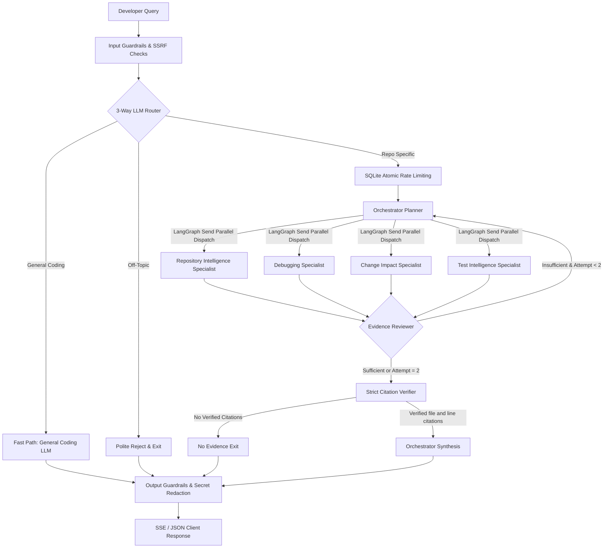

# RepoMind 🧠

**Multi-Agent Codebase Intelligence & Agentic RAG Platform**

RepoMind analyzes GitHub repositories using specialized LangGraph agents for repository intelligence, debugging, change impact analysis, and test coverage synthesis. Backed by AST parsing, SQLite FTS5 documentation caching, and external live documentation retrieval via Exa, Firecrawl v2, and Context7 v3.

---

## Architecture Overview



---

## Project Structure

```
GB/
├── backend/                     # FastAPI, LangGraph multi-agent orchestration, tools & tests
│   ├── app/
│   │   ├── __init__.py
│   │   ├── main.py              # FastAPI application factory and lifespan manager
│   │   ├── config.py            # Environment variables, portable paths, and settings
│   │   ├── schemas.py           # Pydantic request/response models and SSE schemas
│   │   ├── database.py          # SQLite connection, WAL mode, FTS5 cache & atomic rate limits
│   │   ├── budget.py            # Request-scoped ContextVar API budget tracking
│   │   ├── guardrails.py        # SSRF, path sandboxing, prompt injection, and redaction
│   │   ├── api/
│   │   │   ├── routes.py        # /health, /query, and /query/stream endpoints
│   │   │   ├── conversations.py # Conversation management & Supabase sync
│   │   │   └── deps.py          # Actor identity resolution and rate limit dependency
│   │   ├── tools/
│   │   │   ├── local_code.py    # AST inspection, line reader, importers, test discoverer
│   │   │   ├── github_sync.py   # Live GitHub Issues and Actions CI synchronization
│   │   │   └── web_docs.py      # Context7 v3, Exa search, Firecrawl v2 scraping, FTS5
│   │   ├── agents/
│   │   │   ├── base.py          # build_specialist(), history compaction, JSON repair
│   │   │   └── specialists.py   # 4 specialist agent configurations and prompts
│   │   └── graph/
│   │       ├── state.py         # RepoMindState, SpecialistState, and report schemas
│   │       ├── nodes.py         # Orchestrator nodes, routers, AST fast paths
│   │       └── workflow.py      # Compiled StateGraph singleton
│   ├── data/
│   │   └── migrations/          # SQL migrations (Supabase auth & chat history)
│   ├── tests/                   # 31 unit & integration tests
│   ├── pyproject.toml
│   └── requirements.txt
│
└── frontend/                    # React 19 + TypeScript + Vite 8 + Tailwind CSS v4 UI
    ├── components/
    │   └── ui/                  # Wayne retro-styled rare-ui components:
    │                            # ai-status, web-search, streaming-response
    ├── src/
    │   ├── App.tsx              # Main application shell & view routing
    │   ├── components/          # ChatSessionPane, HomeSection, SettingsSection
    │   └── types/               # Chat and session data models
    ├── package.json
    └── vite.config.ts           # Dev proxy to FastAPI backend (port 8001)
│   └── run_all.py               # Complete test discovery runner
│
├── requirements.txt
├── .env.example
├── .gitignore
└── README.md
```

---

## 4 Specialist Agents

1. **Repository Intelligence Agent:** Explores AST symbol trees, function/class declarations, execution paths, dependencies (`pyproject.toml`, `setup.cfg`), and ingested documentation.
2. **Debugging Agent:** Diagnoses runtime errors, exceptions, stack traces, and cross-references synced GitHub Issues and GitHub Actions CI failures.
3. **Change Impact Agent:** Computes the blast radius of code modifications across upstream importers, call-site references, public APIs, and tests.
4. **Test Intelligence Agent:** Discovers test cases, inspects assertions, and audits production modules for untested methods.

---

## Key Reliability & Security Features

* **Concurrency-Safe Budgeting:** Replaced mutable global state with `contextvars.ContextVar[RunBudgetTracker]` ensuring concurrent requests never leak API call quotas or cache hit metrics.
* **Atomic SQLite Rate Limiting:** Uses `BEGIN IMMEDIATE` transactions with WAL mode and `busy_timeout=5000ms` to serialize sliding-window rate checks across multiple Uvicorn workers.
* **Deterministic Citation Verification:** Strict regex parsing and local filesystem resolution for `[file:Lstart-Lend]` citations. Drops ungrounded claims and activates a no-evidence exit when no citations survive verification.
* **SSRF & Path Sandboxing:** Rejects private/loopback/link-local IPs via DNS resolution checks, blocks path traversal (`..`), Windows drive prefixes (`C:`), and symlink escapes.
* **Secret Redaction:** Masks NVIDIA keys (`nvapi-...`), GitHub tokens (`ghp_...`), and API keys in queries and synthesized reports.

---

## Getting Started

### 1. Prerequisites
- Python 3.11+ (Python 3.13 recommended)
- Node.js 20+ (with npm)
- Git

### 2. Environment Setup

Clone the repository and copy the environment template:
```bash
cp .env.example .env
```

Edit `.env` and set your credentials:
```ini
NVIDIA_API_KEY=nvapi-...
GITHUB_TOKEN=ghp_...
EXA_API_KEY=exa-...
FIRECRAWL_API_KEY=fc-...
CONTEXT7_API_KEY=ctx7_...
```

### 3. Backend Installation & Startup

Create and activate a virtual environment, then install backend dependencies:
```bash
uv pip install -r requirements.txt
```

Start the FastAPI backend with Uvicorn:
```bash
uvicorn app.main:app --host 0.0.0.0 --port 8000 --reload
```

The backend is now available at `http://localhost:8000`.
- Swagger Docs: `http://localhost:8000/docs`
- Health check: `http://localhost:8000/health`

### 4. Frontend Startup

In a separate terminal, install dependencies and start the Vite development server:
```bash
cd frontend
npm install
npm run dev
```

Open `http://localhost:3000` in your browser. The Vite development server automatically proxies `/query`, `/query/stream`, and `/health` requests to `http://localhost:8000`.

---

## API Endpoints

### `GET /health`
Returns system readiness, database status, and repository availability:
```json
{
  "status": "ok",
  "repo_name": "psf/requests",
  "repo_available": true,
  "database_ready": true,
  "version": "1.0.0"
}
```

### `POST /query`
Non-streaming JSON query endpoint:
```json
{
  "query": "Explain how Session.send handles connection adapters in requests.",
  "response_style": "detailed"
}
```

### `POST /query/stream`
Server-Sent Events (SSE) streaming endpoint returning real-time LangGraph execution events:
- `event: status` — Current execution phase.
- `event: progress` — Node and specialist progress updates.
- `event: token` — Incremental report text chunks.
- `event: complete` — Final Markdown engineering report, usage metrics, and trace logs.
- `event: error` — Structured error message.

---

## Running the Automated Test Suite

Run the complete test suite with the built-in runner:
```bash
python tests/run_all.py
```

The suite executes 31 tests covering:
- Configuration and portable path resolution (`test_config.py`)
- SQLite WAL mode, FTS5 search, and atomic rate limiting (`test_database.py`)
- Request-scoped ContextVar budget isolation under concurrency (`test_budget.py`)
- Security guardrails, SSRF, path sandboxing, and citations (`test_guardrails.py`)
- AST code inspection and mocked external tools (`test_tools.py`)
- Base specialist agent builder and JSON recovery (`test_agents.py`)
- Compiled StateGraph assembly and routing (`test_graph.py`)
- FastAPI `/health`, `/query`, and `/query/stream` SSE endpoints (`test_api.py`)
